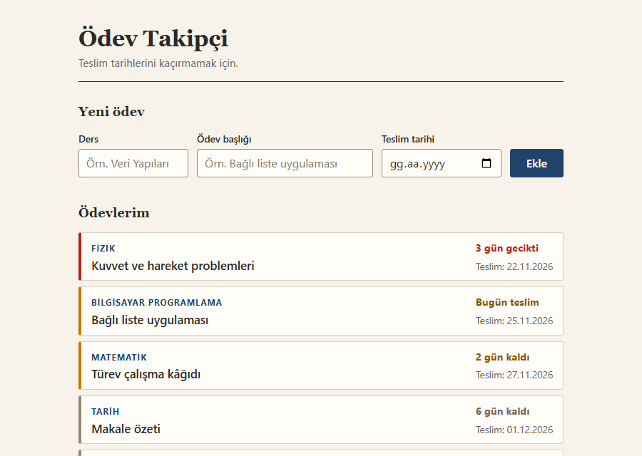
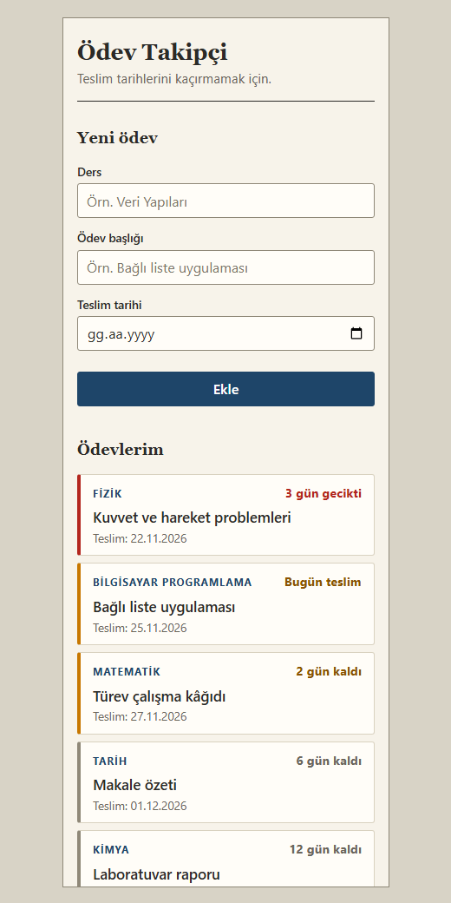

# Ödev Takipçi

Farklı derslerdeki ödev teslim tarihlerini tek bir yerde takip etmeye yarayan basit bir web uygulaması.

**Kurulum gerekmeden denemek için:** https://summitman001.github.io/odev-takipci/

## Hangi problemi çözüyor?

Öğrenciler her dersin ödevini farklı bir yerden öğreniyor ve teslim tarihlerini kaçırabiliyor. Tüm ödevleri ve kalan süreleri tek ekranda gösteren, kurulum gerektirmeyen basit bir araç yok.

## Kimin için?

Aynı dönemde birden fazla ders alan üniversite öğrencileri için. Hesap açmadan, tarayıcıda açıp hemen kullanmak isteyenlere yönelik.

## Proje Panosu

İşlerin takibi GitHub Projects panosunda yapılıyor: [Ödev Takipçi Panosu](https://github.com/users/summitman001/projects/1)

## Çalıştırma

Kurulum gerekmez. Depoyu klonlayıp `index.html` dosyasını tarayıcıda açmanız yeterli:

```bash
git clone https://github.com/summitman001/odev-takipci.git
cd odev-takipci
```

Ardından `index.html` dosyasına çift tıklayın ya da tarayıcınıza sürükleyin.

Uygulama HTML, CSS ve sade JavaScript ile yazıldı. Veriler tarayıcının localStorage'ında tutulur; sunucu ya da veritabanı yoktur. `main` dalına yapılan her değişiklik GitHub Actions ile otomatik olarak yukarıdaki canlı siteye yayınlanır.

## Özellikler ve Nasıl Denenir

### 1. Ödev ekleme ve listeleme

Ders adı, ödev başlığı ve teslim tarihi girilerek ödev eklenir. Ödevler sayfa yenilense de kaybolmaz.

1. Canlı siteyi ya da `index.html` dosyasını açın.
2. Üç alanı doldurup **Ekle**'ye basın. Ödev "Ödevlerim" bölümünde görünür ve form temizlenir.
3. Alanlardan birini ya da hepsini boş bırakıp **Ekle**'ye basın. Ödev eklenmez, eksik alanları belirten bir uyarı formda görünür.
4. Birkaç ödev ekleyip sayfayı yenileyin (F5). Ödevler listede kalır.

### 2. Teslim tarihine göre sıralama ve kalan gün

Ödevler en yakın tarihten başlayarak dizilir. Her ödevde "X gün kaldı", "Bugün teslim" ya da "X gün gecikti" yazar. Geçmiş ödevler kırmızı, 3 gün veya daha az kalanlar (bugün dahil) turuncu görünür.

1. Bugüne göre şu ödevleri karışık sırayla ekleyin: 5 gün önce, 1 gün önce, bugün, yarın, 3 gün sonra, 4 gün sonra, 10 gün sonra.
2. Liste eklediğiniz sıraya bakılmadan en eski tarihten en yeniye dizilmeli.
3. Yazılar sırasıyla "5 gün gecikti", "1 gün gecikti", "Bugün teslim", "1 gün kaldı", "3 gün kaldı", "4 gün kaldı", "10 gün kaldı" olmalı.
4. İlk iki ödevin sol çizgisi ve kalan süre yazısı kırmızı, bugün/yarın/3 gün sonrası hardal (turuncu), 4 gün ve sonrası gri olmalı.
5. 2 gün sonrası için yeni bir ödev ekleyin. Liste yeniden sıralanır, ödev doğru yere girer.

### 3. Arayüz

Arayüz krem renkli bir kâğıt ajandayı andırır: serif başlık, tek vurgu rengi (mürekkep mavisi), en fazla 4px köşe yuvarlaklığı; degrade ve gölge yok. Her ödev ince kenarlıklı bir satırdır. Ders adı küçük harflerle üstte, kalan gün sağda düz yazı olarak görünür. Durum sol kenardaki çizgiyle de anlaşılır: geciken kırmızı, 3 gün ve altı turuncu, daha fazlası gri. Ödev yokken kısa bir boş durum yazısı çıkar. Düzen masaüstünde ve telefon genişliğinde (375px) çalışır.

| Masaüstü | Mobil (375px) |
|---|---|
|  |  |

1. Siteyi ilk kez açın ya da tarayıcı konsolunda `localStorage.clear()` çalıştırıp sayfayı yenileyin. "Henüz ödev yok. Yukarıdan ilkini ekle." yazısı italik ve gri olarak görünmeli.
2. Birkaç ödev ekleyin. Her ödev ince kenarlıklı bir satır olmalı: ders adı üstte küçük harflerle, kalan gün sağda düz yazıyla, durum rengi sol çizgide.
3. Tarayıcı penceresini daraltın (ya da geliştirici araçlarında 375px genişliği seçin). Form alanları alt alta dizilmeli, hiçbir şey taşmamalı.

Sıradaki özellikler (tamamlama, silme, filtreleme) için panoya bakabilirsiniz.
